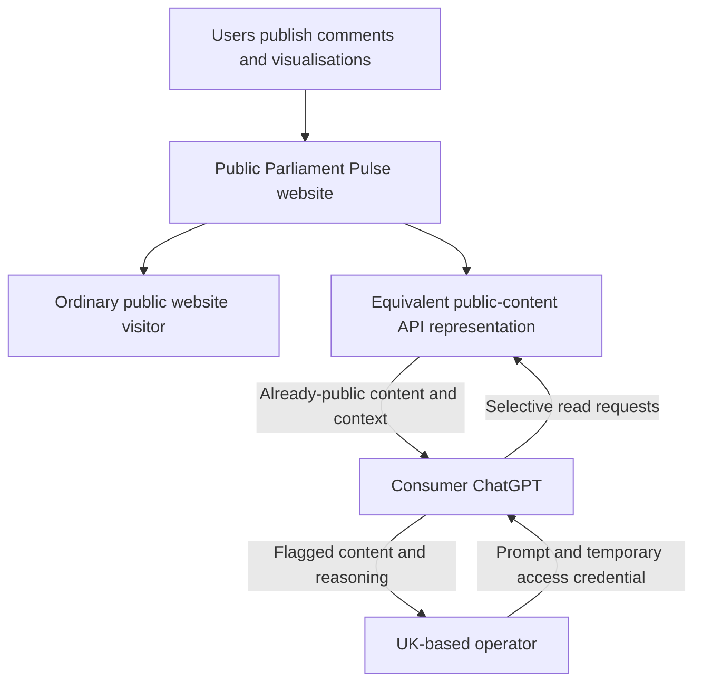

# Parliament Pulse — UK GDPR and AI-assisted moderation

**Status:** Internal regulatory reference and record of the operator's chosen interpretation  
**Date:** 24 November 2026  
**Jurisdiction:** United Kingdom  
**Scope:** Data protection, disclosure to OpenAI and international transfers in connection with AI-assisted review of public content. This document does not assess Ofcom, the Online Safety Act or the platform's substantive moderation obligations.

## 1. Executive summary and recorded decision

Parliament Pulse is a personal, currently non-commercial project operated by a UK-based individual. It provides tools for exploring UK parliamentary and political datasets, creating and sharing visualisations, and participating in public discussions.

The operator intends to retain the option of using ordinary consumer ChatGPT to investigate public content, through temporary-key-authenticated endpoints that expose information already available to any visitor to the website. The operator has disabled use of ChatGPT conversations for model training. An OpenAI Moderation API integration also exists and must be treated as a separate processing arrangement.

**Recorded operator decision (24 November 2026):** The operator adopts the position that the proposed public-content retrieval by ChatGPT is not a restricted international transfer initiated by Parliament Pulse. The rationale is that ChatGPT retrieves material already genuinely available to the general public, using its own retrieval infrastructure, and the authenticated interface is merely a more convenient representation of that same material. It does not grant access to additional, non-public personal data. The intended relationship for ordinary consumer ChatGPT is one between independent controllers rather than a controller and its processor.

The operator intends the content policy to say that public content **may be processed by ChatGPT** for moderation, rather than promising that it will always be processed in this way. The operator is not relying on mandatory user declarations, user initiation, a consent checkbox, or relocating servers abroad as the justification for the absence of a restricted transfer.

**Legal status of that decision:** This records the operator's position, not an established exemption or a legal finding that the workflow is compliant. The public-source argument has a relevant historical judicial foundation, but the ICO's current guidance expressly addresses deliberate remote access and who arranges it. On the facts described, there is a substantial risk that the ICO would regard the operator as initiating a restricted transfer. The operator's conclusion is therefore a disputed interpretation, not the outcome most clearly supported by the current ICO guidance. No directly applicable UK judgment or ICO determination on this particular agentic AI scenario was identified. A correct controller-to-controller classification would not resolve the transfer issue on its own.

This is a reference and decision record, not a completed legitimate interests assessment (LIA), data protection impact assessment (DPIA), transfer risk assessment (TRA), or independent legal opinion. The underlying implementation, account terms, data flows and personal-data fields have not been audited.

## 2. Project and processing context

### 2.1 Website functionality

Parliament Pulse allows users to:

- Explore datasets relevant to the UK Parliament and create and publicly share data visualisations.
- Comment on other users' visualisations and reply to their comments.
- Comment on parliamentarians, constituencies, election candidates, political donors, and parties or other persons described in parliamentary interest declarations.

The subjects of personal data therefore include not only registered users but also identifiable public figures, candidates, individual donors, and people mentioned in comments or underlying datasets. A corporate donor or a constituency is not itself a natural person, although associated records can identify natural persons.

### 2.2 Two different AI workflows

| Workflow | Description | Contractual context |
|---|---|---|
| OpenAI Moderation API | Existing screening mechanism using the OpenAI `/v1/moderations` endpoint. | Developer/API service; OpenAI's business DPA is available for covered services. |
| Consumer ChatGPT | Operator manually requests an investigation. ChatGPT may make successive read requests to retrieve comments, visualisations and relevant surrounding context, then identify material for the operator to review. | Ordinary personal ChatGPT account; standard business DPA is not assumed to cover it. |

Conceptual data flow for the second workflow:

The diagram is conceptual: it does not specify actual hosting providers, endpoints, fields or OpenAI infrastructure. The operator reports that the API-accessible information is already public; this equivalence has not been independently verified.

### 2.3 Boundaries of the recorded position

The public-source argument is limited to already-published, genuinely public information. In particular, it does not automatically cover:

- Unpublished, draft, pending-review, hidden, deleted, restricted or private content.
- Non-public account identifiers, email addresses, IP addresses, security or access logs, private messages, reports submitted confidentially, or internal moderation notes.
- A private or enriched user profile that combines public data with information unavailable to ordinary visitors.
- Bulk exports, systematic cross-thread profiles or computed information not actually exposed to public users merely because the underlying source records are public.
- Uploading a private export or file into ChatGPT, even if it happens to reproduce some public content.

The temporary key is understood as a technical access control for a public-data interface, not a grant of privileged access to additional information. This is an important factual premise, not a legal exemption in itself. A key's security properties (scope, expiration, revocation and read-only permissions) are separate from the legal question of who initiated retrieval.

## 3. Applicable law and public personal data

### 3.1 Legislative framework

Primary legislation:

- [UK GDPR — consolidated legislation](https://www.legislation.gov.uk/eur/2016/679/contents).
- [Data Protection Act 2018](https://www.legislation.gov.uk/ukpga/2018/12/contents), especially section 10 and Schedule 1 for sensitive and criminal offence data.
- [Data (Use and Access) Act 2025 (DUAA)](https://www.legislation.gov.uk/ukpga/2025/18/contents), including [Schedule 7](https://www.legislation.gov.uk/ukpga/2025/18/schedule/7) on international transfers and [section 80](https://www.legislation.gov.uk/ukpga/2025/18/section/80) on automated decisions. Relevant amendments took effect on 5 February 2026. Older guidance referring to former Article 44 or Article 22 must be read against the amended law.

UK GDPR Article 4(1) covers information relating to an identified or identifiable natural person; Article 4(2) includes collecting, consulting, using, disclosing and making data available within processing. Public accessibility does not negate either definition.

A pseudonymous username, comment ID or public profile can still be personal data if a person is reasonably identifiable. Public parliamentary records and political information about identifiable individuals can also be personal data. A visualisation consisting solely of genuinely anonymous aggregate statistics may fall outside the UK GDPR, but its author details and accompanying comments may not.

Article 5 requires lawful, fair and transparent processing, purpose limitation, data minimisation, accuracy, storage limitation and security. Article 5(2) makes the controller accountable for compliance; Article 24 requires appropriate measures to demonstrate it. Article 25 concerns data protection by design and default.

### 3.2 Personal or household activity exemption

Article 2(2)(a) excludes an individual's purely personal or household processing; Recital 18 addresses private activity including certain online and social networking activities. Parliament Pulse's non-commercial status, personal operation and manually initiated AI review are relevant facts. No revenue or commercial intent today is not sufficient by itself to establish this exemption for a platform open to the public.

In [*Bodil Lindqvist*, C-101/01, 6 November 2003, paragraphs 46–48](https://eur-lex.europa.eu/legal-content/EN/TXT/?uri=CELEX%3A62001CJ0101), the Court of Justice considered a private individual's public webpages and rejected the domestic exemption for publication of others' information to an indefinite audience. This concerned predecessor legislation and is not an exact analogy to a website on which users publish their own content. It nevertheless illustrates why a public hobby platform should not automatically be treated as a purely private activity.

For purposes of the analysis below, assume the UK GDPR applies to the operator's processing. The recorded transfer decision is not dependent on the household exemption.

ICO source: [Data protection principles, definitions and key terms](https://ico.org.uk/for-organisations/advice-for-small-organisations/getting-started-with-gdpr/data-protection-principles-definitions-and-key-terms).

## 4. Lawful basis for AI-assisted content review

### 4.1 Article 6(1)(f): ordinary legitimate interests

The proposed basis for routine AI-assisted moderation is ordinary legitimate interests. No separate GDPR consent is inherently necessary for processing lawfully undertaken on this basis. The operator should establish this basis before processing begins, including for disclosure to an independent controller.

The ICO uses a three-part test:

| Test | Parliament Pulse application |
|---|---|
| Purpose | Protect participants, maintain constructive discussion, detect abuse and enforce the platform's content policy. |
| Necessity | Contextual AI review may help a lone operator handle public content accurately and proportionately. Agentic retrieval can obtain only relevant surrounding context instead of sending entire histories. Compare with feasible alternatives, including the existing screening API and manual review; convenience alone does not establish necessity. |
| Balancing | Consider public posting and reasonable expectations, the moderation notice, limited access, no training opt-in, human judgement, data sensitivity, potential chilling effects on political participation, errors, and impact on users and people discussed. |

A documented LIA should cover the actual data flow, not just moderation in the abstract. It should also account for non-users whose information appears in the platform. Public availability helps the balancing assessment but does not settle it.

Sources: [ICO legitimate interests guidance (updated March 2026)](https://ico.org.uk/for-organisations/uk-gdpr-guidance-and-resources/lawful-basis/a-guide-to-lawful-basis/legitimate-interests); [ICO practical LIA guidance](https://ico.org.uk/for-organisations/uk-gdpr-guidance-and-resources/lawful-basis/legitimate-interests/how-do-we-apply-legitimate-interests-in-practice/); [ICO guide to lawful basis](https://ico.org.uk/for-organisations/uk-gdpr-guidance-and-resources/lawful-basis/a-guide-to-lawful-basis/).

### 4.2 Other bases and limits

Article 6(1)(c) applies only where processing is necessary to fulfil an applicable legal obligation; Article 6(1)(b) requires objective contractual necessity, not merely inclusion in terms. The newer recognised legitimate interests basis in Article 6(1)(ea) is confined to specified statutory purposes, not routine content review generally. No such basis is being asserted here in place of Article 6(1)(f).

A content-policy acknowledgement is useful evidence of transparency but is not necessarily freely given consent under Articles 4(11) and 7. It cannot disapply Article 28, Article 9, Article 10 or Chapter V. A user's agreement also cannot automatically authorise processing another person's information.

## 5. Controller-to-controller versus controller-to-processor

### 5.1 Legal test

Article 4(7) identifies a controller by its determination of the purposes and means of processing; Article 4(8) defines a processor by its processing on behalf of a controller. Article 28 requires binding processor terms. Article 26 separately governs joint controllers.

The classification is objective and processing-specific. Neither a provider's contractual description nor the operator's preference establishes it conclusively. A provider can have different roles for different operations. The ICO expects organisations to assess and record their roles under the accountability framework; there is no general requirement to obtain a regulator's or recipient's advance approval of an independent-controller assessment.

Sources: [ICO AI accountability and governance guidance](https://ico.org.uk/for-organisations/uk-gdpr-guidance-and-resources/artificial-intelligence/guidance-on-ai-and-data-protection/what-are-the-accountability-and-governance-implications-of-ai/); [ICO data sharing agreements](https://ico.org.uk/for-organisations/uk-gdpr-guidance-and-resources/data-sharing/data-sharing-a-code-of-practice/data-sharing-agreements/).

### 5.2 Evidence in relation to ordinary ChatGPT

OpenAI's [European Privacy Policy](https://openai.com/en-GB/policies/eu-privacy-policy/) applies to UK users and distinguishes the consumer service from content processed for customers of its business offerings. Sections 2 and 9 describe its service purposes and legal bases, including responding to prompts; section 12 identifies OpenAI OpCo, LLC as the controller under the policy for UK residents. Section 10 describes its own international transfer arrangements. The policy is evidence about OpenAI's consumer processing; it is not a signed controller-to-controller transfer agreement with Parliament Pulse and does not conclusively classify the processing of third-party comments.

| Supports independent-controller interpretation | Supports processor interpretation |
|---|---|
| OpenAI runs a general-purpose consumer service under its own privacy policy and determines its own service-level data handling. | The operator determines why comments are being reviewed and instructs ChatGPT to perform a particular analysis. |
| OpenAI defines independent purposes such as service provision, security and compliance. | The specific analysis serves the operator's moderation purpose; OpenAI may perform it on the operator's behalf. |
| OpenAI controls the retrieval infrastructure and operation of the consumer service. | Choosing technical implementation details is compatible with being a processor; the operator chooses the service and accessible sources. |

**Recorded intended classification:** independent controller to independent controller for the consumer ChatGPT workflow. There is supporting evidence, but there remains a meaningful risk that OpenAI is a processor for the specific moderation operation even if it is a controller for its own service activities. This has not been confirmed by OpenAI, the ICO or a court.

If the independent-controller classification is correct, an ordinary bilateral data sharing agreement is good practice but not generally mandatory under UK GDPR. This does not remove international transfer safeguards or the need to assess the recipient's handling of data. If OpenAI is a processor for the operation, an Article 28-compliant binding agreement is mandatory. If the parties jointly determine purposes and essential means, Article 26 must instead be considered.

### 5.3 Consumer versus developer contracts

- [OpenAI Europe Terms of Use](https://openai.com/policies/eu-terms-of-use/): terms applicable to UK consumer users.
- [OpenAI Services Agreement](https://openai.com/en-GB/policies/services-agreement/) and [Data Processing Addendum](https://openai.com/en-GB/policies/data-processing-addendum/): contractual framework for covered business/developer services. The DPA's section 4.2 incorporates UK international transfer clauses for covered UK data.

The operator reports that the DPA execution page expressly excludes ordinary consumer ChatGPT. No general Article 28 DPA for the ordinary consumer chat workflow was identified. The API DPA should not be treated as covering consumer chats simply because the same individual also uses the developer API. Accepting or executing the DPA means entering a binding agreement for the covered services; it does not extend its scope to an excluded service.

## 6. International transfers — the central disputed issue

### 6.1 The statutory framework

UK GDPR Chapter V governs transfers to third countries and international organisations. Following DUAA Schedule 7, the current general provision is Article 44A; former Article 44 was omitted on 5 February 2026. Article 44A provides routes through applicable adequacy regulations, appropriate safeguards or statutory exceptions. Articles 45 onwards address those routes.

See [DUAA Schedule 7, paragraph 2 (Article 44A)](https://www.legislation.gov.uk/ukpga/2025/18/schedule/7/paragraph/2) and the [ICO's international transfers guide](https://ico.org.uk/for-organisations/uk-gdpr-guidance-and-resources/international-transfers/a-guide-to-international-transfers/).

The term *restricted transfer* concerns the transfer operation, not whether the information itself was secret or restricted. The law does not contain a general exception for public personal data.

### 6.2 The ICO's current test (January 2026 guidance)

The ICO identifies three elements:

1. The processing concerned falls within UK GDPR.
2. The organisation initiates a transfer to a recipient established outside the UK.
3. The recipient is legally separate from the originating organisation.

For Parliament Pulse, assume element 1 is satisfied; OpenAI's separate US entity satisfies the location/separateness premise for elements 2 and 3. The disputed element is whether there is a transfer initiated by Parliament Pulse.

The ICO expressly includes remote accessibility in its approach. Where an overseas organisation accesses data made available to it, the required safeguards should already be in place. The ICO defines initiation as follows:

> Initiating a transfer is making the initial decision that causes the transfer to happen.

It distinguishes that decision from authorisation and from technical transmission, looking at the arrangement's design, recipient choice and contractual relationships. The ICO also focuses on the recipient's establishment, not server geography.

**Primary source:** [ICO — Are we making a restricted transfer?](https://ico.org.uk/for-organisations/uk-gdpr-guidance-and-resources/international-transfers/a-guide-to-international-transfers/are-we-making-a-restricted-transfer/), particularly Step two, the discussion of remote access and initiation, the rule of thumb and the worked examples. See also [What is an international transfer of personal information?](https://ico.org.uk/for-organisations/uk-gdpr-guidance-and-resources/international-transfers/a-guide-to-international-transfers/what-is-an-international-transfer-of-personal-information) and the [15 January 2026 guidance update](https://ico.org.uk/about-the-ico/media-centre/news-and-blogs/2026/01/updated-guidance-on-international-transfers-published/).

### 6.3 Legal support for the public-source argument: Lindqvist

In [*Bodil Lindqvist*, C-101/01, paragraphs 54–71 and operative ruling 4](https://eur-lex.europa.eu/legal-content/EN/TXT/?uri=CELEX%3A62001CJ0101), the Court of Justice held that placing personal data on an internet page hosted by a person established within the relevant European territory did not, by itself, constitute a transfer to a third country merely because the page was globally accessible. The case interpreted Article 25 of Directive 95/46/EC, the predecessor of GDPR.

Relevant aspects of the reasoning:

- Paragraph 55 records the UK government's distinction between overseas accessibility and transfer.
- Paragraphs 60–61 examine how overseas readers actively seek out online material rather than receiving a direct transmission from the publisher.
- Paragraphs 68–71 explain why treating general internet publication as a third-country transfer would produce far-reaching and disproportionate consequences for online publication.

This supports a distinction between publication to the public generally and a transfer directed at a specific overseas recipient. It does not establish that subsequent deliberate disclosure of that information to an identified foreign organisation is exempt. The case involved a European hosting arrangement and did not address AI agents, purpose-specific retrieval APIs or commissioned analysis. Its reasoning is relevant background but its application to the amended UK GDPR requires separate analysis; it is not a dispositive ruling on this workflow.

For comparative context, the [EDPB Guidelines 05/2021 on Article 3 and Chapter V](https://www.edpb.europa.eu/documents/guideline/guidelines-052021-on-the-interplay-between-the-application-of-article-3-and-the_en) address the meaning of a transfer under EU GDPR. They are not binding current UK ICO guidance; UK and EU transfer interpretations can differ.

### 6.4 Operator's adopted interpretation and justification

The position being recorded is **not** that all transfers of public information are unregulated. It is that this particular retrieval is not a new international transfer initiated by Parliament Pulse.

The reasoning is:

1. The relevant information has already been published to the public generally, including people abroad. Its public accessibility exists before and independently of a particular ChatGPT session.
2. Any visitor, including an overseas organisation or a person directing an AI agent, can obtain the same information through ordinary navigation of the public website.
3. The purpose-built endpoint provides a machine-readable representation of public material. The temporary credential does not expand the available personal-data set or confer privileged access to the underlying personal data.
4. ChatGPT uses its own retrieval system to choose and execute relevant requests, including requests for context; it can decline or limit the investigation. The operator does not upload a database export in the intended workflow.
5. The server's response is characterised by the operator as ordinary retrieval of material previously published to the world rather than a fresh directed export of personal data. This is analogous, on that interpretation, to researching a public website.
6. The fact that the operator seeks moderation assistance, rather than an unrelated third party seeking the same material, does not change the public status of the information. HTML versus JSON is a representation difference rather than inherently a different disclosure of information.

The operator therefore adopts the view that element 2 of the ICO test is not satisfied for this narrowly described workflow. No Data Bridge certification, contractual transfer mechanism or Article 49 derogation is being relied on for that workflow on the premise that Chapter V is not triggered.

### 6.5 Counterarguments and assessment of legal risk

The strongest contrary argument is that general publication and subsequent targeted retrieval are distinct processing operations. Even if publishing a webpage does not itself amount to a transfer, the operator may arrange a later disclosure by selecting OpenAI, prompting it to fetch information for the operator's own purpose, creating a dedicated access interface and issuing a key.

The agent's discretion over individual HTTP requests does not necessarily change who arranged the processing. An ordinary overseas service provider can likewise decline a request or make its own technical decisions. Under the current ICO approach, the operator's initial instruction and architecture choices may establish initiation even if the data moves only in response to an incoming request.

| Scenario | Assessment (interpretive, not a ruling) |
|---|---|
| An overseas visitor independently browses the public website | Strongest case for no operator-initiated restricted transfer. |
| An independent search engine or AI crawler discovers the site | Similar, assuming no special arrangement. |
| An unrelated ChatGPT user instructs it to browse the site | The operator has not commissioned that retrieval; different from the proposed moderation workflow. |
| The operator specifically asks ChatGPT to navigate the public website | Public-source argument remains available, but deliberate selection and instruction weigh against it. |
| The operator gives ChatGPT a temporary key to an equivalent public-data endpoint | Chosen position is that this is the same public-source retrieval; however, the dedicated integration adds evidence of arrangement and initiation. |
| The operator directly uploads or sends a CSV of public comments | Strong case for a new directed transfer; not covered by the chosen interpretation. |

Article 49 also contains a limited exception for transfers from a register established under law and open to public consultation. That exception illustrates that public information can still be subject to Chapter V. Parliament Pulse's own comment database is not such a statutory register simply because it is public. Public records sourced from Parliament do not automatically turn a private aggregation into one either.

**Assessment:** The operator's argument is coherent and worth recording, but the more conservative and, on the published ICO guidance, stronger interpretation is that the intended targeted retrieval constitutes a restricted transfer. It is not necessary for information to have been previously inaccessible to the recipient. Identical data content and low incremental privacy risk are not decisive legal tests. There is no identified safe harbour for this configuration. If the interpretation is wrong, a good-faith documented assessment does not make the transfer lawful or prevent enforcement.

### 6.6 Arguments considered but not adopted

- **User initiation:** Merely stating that the user decides to send the information, or requiring a submission button to that effect, does not establish that the user arranged the transfer. The operator has selected the provider and architecture. This route has been abandoned.
- **Hosting in America:** Moving a server does not remove a disclosure between a UK GDPR-covered controller and a separate US organisation. Any initial hosting arrangement must also be assessed on its own facts.
- **AI agency as the sole criterion:** The timing of the technical request and the ability to refuse are not by themselves decisive. They form part of the broader public-source argument only.
- **Public data as a blanket exception:** Rejected as a statement of the legislation. The actual decision depends on the asserted absence of an initiated transfer, not on the personal data being exempt by virtue of publication.

## 7. Transfer mechanisms if the chosen interpretation is not accepted

These are the legal alternatives, not the basis of the operator's current consumer ChatGPT decision.

| Mechanism | Application |
|---|---|
| Article 45 / adequacy regulations | The UK-US Data Bridge applies only to qualifying US recipients with active UK Extension certification covering the relevant data. The operator reports finding no qualifying OpenAI organisation; no certification is relied on here. That negative search has not been independently verified. |
| Article 46 / appropriate safeguards | The UK International Data Transfer Agreement (IDTA) or EU standard contractual clauses with the UK Addendum may provide a route where properly agreed. A TRA/data protection test is required as applicable. A consumer privacy policy or the fact that the data is public does not substitute for such an agreement. |
| Article 49 / exceptions | Explicit, informed, freely given consent to the transfer is one possible exception, with risk disclosure in the absence of adequacy/safeguards. Other exceptions have specific necessity and eligibility conditions. None is established for the intended consumer workflow. |
| Covered developer/API workflow | OpenAI's business DPA includes contractual UK transfer safeguards. An agentic API implementation can preserve contextual retrieval without relying on the consumer-workflow interpretation, subject to confirming scope and completing the applicable assessment. |
| Genuinely anonymous data or local processing | Anonymous information is outside UK GDPR; a genuinely local workflow without an overseas recipient avoids this particular international disclosure. Pseudonymisation alone is insufficient. |

Sources:

- [ICO — UK Extension to the EU-US Data Privacy Framework](https://ico.org.uk/for-organisations/uk-gdpr-guidance-and-resources/international-transfers/adequacy-regulations/how-does-the-uk-extension-to-the-eu-us-data-privacy-framework-work); [US DPF public register](https://www.dataprivacyframework.gov/list).
- [ICO — Completing a transfer risk assessment](https://ico.org.uk/for-organisations/uk-gdpr-guidance-and-resources/international-transfers/completing-a-transfer-risk-assessment/) (now termed a data protection test in legislation); [using the UK government's US analysis](https://ico.org.uk/for-organisations/uk-gdpr-guidance-and-resources/international-transfers/completing-a-transfer-risk-assessment/completing-a-tra-using-the-uk-government-s-analysis-us/).
- [ICO — Rules on exceptions](https://ico.org.uk/for-organisations/uk-gdpr-guidance-and-resources/international-transfers/using-an-exception/what-are-the-rules-on-exceptions/); [specific exceptions including consent and public registers](https://ico.org.uk/for-organisations/uk-gdpr-guidance-and-resources/international-transfers/using-an-exception/what-are-the-exceptions/).

A transfer exception, if applicable, would not cure a missing Article 28 contract where a processor relationship exists. The data bridge and contractual safeguards likewise do not eliminate the need for a lawful basis, transparency and sensitive-data conditions.

## 8. Special category and criminal offence data: particular relevance to Parliament Pulse

### 8.1 Article 9 — political opinions and other special categories

Article 9(1) covers personal data revealing political opinions, alongside other sensitive categories including health, religious beliefs, ethnicity, trade union membership and sexual orientation. An Article 6 basis is necessary but not sufficient: a separate Article 9(2) condition must be identified when such data is processed.

Because the website concerns Parliament and politics, this is a central issue, not a rare edge case. Political discussion is not invariably special category data, but identifiable persons' stated political opinions, affiliations and certain inferred political views may be. Moderation need not involve intentional profiling for the actual content being processed to reveal a political opinion.

**Article 9(2)(e)** permits processing of data manifestly made public by the data subject. The ICO looks at whether that particular person deliberately made the particular information publicly available. Information appearing in public is not by itself enough.

| Example | Assessment |
|---|---|
| A user deliberately posts that they support a named political party on an explicitly public comment page | Article 9(2)(e) may apply to that disclosed opinion, alongside an Article 6 basis. |
| An MP publicly identifies their party affiliation or states a political position in a public speech | Potentially manifestly made public by the MP; ICO guidance specifically discusses public political affiliations of MPs. |
| A candidate publicly declares their own affiliation in campaign material | Potentially within Article 9(2)(e) for that information. |
| A comment claims another person supports a political party or has a health condition | The person concerned may not have made this public; the author's act of posting is not sufficient. |
| A donor is identified in a statutory disclosure or register | Consider what the donor themselves deliberately disclosed and whether the information reveals political opinions. Statutory publication by another party is not automatically a deliberate disclosure by the donor. |
| AI infers an identifiable user's political allegiance from posting patterns | May be special category data. The inference is not necessarily something the person themselves made public. |
| Aggregate constituency voting statistics that do not identify any voter | Not ordinarily personal data in their genuinely anonymous aggregate form. |

Other Article 9 conditions, such as explicit consent or substantial public interest under Article 9(2)(g) with a qualifying Data Protection Act 2018 Schedule 1 condition, may apply in defined cases. There is no general substantial-public-interest permission for processing all political content. Some Schedule 1 conditions require an appropriate policy document. The website's civic focus alone does not establish a statutory condition or a political-party exemption.

Sources: [ICO — what is special category data?](https://ico.org.uk/for-organisations/uk-gdpr-guidance-and-resources/lawful-basis/special-category-data/what-is-special-category-data/); [ICO — conditions for processing, including manifestly made public](https://ico.org.uk/for-organisations/uk-gdpr-guidance-and-resources/lawful-basis/special-category-data/what-are-the-conditions-for-processing/); [ICO — special category rules](https://ico.org.uk/for-organisations/uk-gdpr-guidance-and-resources/lawful-basis/special-category-data/what-are-the-rules-on-special-category-data/); [DPA 2018 Schedule 1](https://www.legislation.gov.uk/ukpga/2018/12/schedule/1).

### 8.2 Article 10 — criminal allegations and convictions

Public discussion of parliamentarians, candidates and donors may include allegations of criminal conduct, investigations or convictions. Article 10 imposes separate restrictions on personal data concerning criminal offences and convictions. A private controller ordinarily needs an applicable condition under UK law (DPA 2018 section 10 and Schedule 1) as well as an Article 6 basis. The Article 9(2)(e) condition does not itself authorise Article 10 processing.

A public accusation is not proof that the allegation is true. AI-generated flags or descriptions should not be converted into assertions of criminal conduct. Where no applicable Article 9 or 10 condition can be established for a particular operation, public availability and the transfer decision do not cure that problem.

Sources: [ICO — criminal offence data](https://ico.org.uk/for-organisations/uk-gdpr-guidance-and-resources/lawful-basis/a-guide-to-lawful-basis/criminal-offence-data); [ICO — what is criminal offence data?](https://ico.org.uk/for-organisations/uk-gdpr-guidance-and-resources/lawful-basis/criminal-offence-data/what-is-criminal-offence-data/); [DPA 2018 section 10](https://www.legislation.gov.uk/ukpga/2018/12/section/10).

## 9. Transparency and the intended content-policy wording

The operator has decided to use conditional wording: public content **may** be processed by ChatGPT. This accurately reserves discretion if a different moderation mechanism is chosen or legal requirements change. An illustrative description of that decision is:

> Public comments, replies, shared visualisations and relevant publicly visible discussion context, including public usernames where necessary, may be reviewed using AI-assisted tools, including ChatGPT provided by OpenAI. Such processing may take place outside the United Kingdom and is used to assist with content moderation.

This is illustrative, not a complete privacy notice or an assertion that the transfer is lawful. It does not represent GDPR consent, shift initiation to the user or create a transfer mechanism.

Articles 12–14 require intelligible information about processing. The privacy notice, distinct from the content policy, needs to describe actual processing purposes, lawful bases and relevant interests, recipients or their categories, overseas processing and applicable safeguards where relevant, retention, data-subject rights, controller contact details and other required particulars. For third-party data from datasets or comments, Article 14 may apply; assess any applicable exception rather than assuming public availability removes the information obligation.

Article 21 provides a right to object to legitimate-interest processing; Articles 15–18 and other applicable provisions provide rights of access, correction, erasure and restriction, subject to their conditions. The workflow must allow these rights to be handled in practice. If a comment is removed from public access, the retrieval interface should not continue to expose it under the already-public-data rationale.

Source: [ICO — Right to be informed](https://ico.org.uk/for-organisations/uk-gdpr-guidance-and-resources/individual-rights/individual-rights/right-to-be-informed/).

## 10. OpenAI data handling and practical GDPR implications

### 10.1 Consumer ChatGPT

The operator reports disabling model training. OpenAI's [Data Controls FAQ](https://help.openai.com/en/articles/7730893-data-controls-in-chatgpt) describes opting out and the exception where feedback is voluntarily submitted on a conversation. Opt-out is a meaningful reduction in risk but is not a DPA, an international transfer safeguard, a guarantee of immediate deletion or a guarantee that public internet data will never independently be collected for model development.

The consumer [privacy policy](https://openai.com/en-GB/policies/eu-privacy-policy/) describes retention, security, disclosures and data subject rights. Conversation content and retrieved context may be stored or otherwise processed under those terms. Deleting chats or using Temporary Chat where compatible with the workflow can reduce retention, but applicable safety/legal retention exceptions and provider terms must be considered. The operator's chosen consumer account settings and actual retention practices have not been inspected.

Source: [OpenAI — How OpenAI handles data in consumer services](https://help.openai.com/en/articles/7039943-how-openai-handles-data-in-consumer-services).

### 10.2 Moderation API

The [OpenAI API data controls documentation](https://developers.openai.com/api/docs/guides/your-data) lists `/v1/moderations` as not used for training, with no abuse-monitoring retention, no application-state retention and eligibility for Zero Data Retention. This is endpoint-specific and should not be extrapolated to consumer chats or other API endpoints. The business DPA and UK Addendum arrangements, including the applicable transfer assessment, are relevant to this separate API workflow. No assumption is made that the API is exempt from Chapter V merely because a submitted comment is public; in particular, pre-publication submissions would not meet the chosen public-retrieval premise.

### 10.3 Data minimisation, security and retention

Articles 5, 25 and 32 are relevant regardless of the transfer classification. Appropriate controls for the stated design include narrow read-only credentials, short expiration, revocation, limiting retrieval to relevant public records, avoiding unnecessary identifiers, excluding private/internal material, and preventing unlimited extraction. Comments and visualisation metadata are untrusted inputs; an agent must not be able to expand its access or execute actions simply because content instructs it to do so. These are safeguards and scope conditions, not a determination that the current implementation already satisfies them.

Replacing public usernames with temporary references may reduce unnecessary disclosure but does not necessarily anonymise the material: public comment text can itself be searchable and linkable. Contextual retrieval and recorded outputs should be limited to what the stated review purpose requires. Deletion/retention arrangements need to reflect the actual service and local records.

### 10.4 Automated decisions and provider terms

Following DUAA section 80, UK GDPR Articles 22A–22D govern significant decisions based solely on automated processing. They include safeguards and particular restrictions for sensitive-data processing and recognised legitimate interests. The relevant distinction is meaningful human involvement, not merely a human formally accepting an AI result. The intended consumer workflow is operator decision support rather than autonomous enforcement; the exact behaviour of the existing moderation system has not been audited.

OpenAI's consumer Europe Terms of Use separately restrict using outputs relating to people for purposes that could have a legal or material impact on them. Content flagging and independent examination of underlying comments should be distinguished from profiling individuals or deciding significant sanctions based on AI output. Human review reduces data-protection risks but does not automatically establish compliance with the contractual restriction. This is a separate contractual question, not a GDPR transfer mechanism.

Sources: [DUAA section 80](https://www.legislation.gov.uk/ukpga/2025/18/section/80); [OpenAI Europe Terms of Use](https://openai.com/policies/eu-terms-of-use/).

## 11. Accountability, review and limitations

### 11.1 DPIA and documentation

Article 35 requires a DPIA where processing is likely to create high risk to individuals. The ICO identifies combinations of innovative technology and additional risk criteria, such as sensitive data or evaluation/scoring, as circumstances requiring particular attention. Parliament Pulse's political content, AI analysis and possible consequences for identifiable users mean a DPIA is likely to be required if that combination is present in practice. A small hobby project is not automatically exempt. Article 36 may require prior consultation if high residual risk remains after mitigation.

Sources: [ICO — When do we need to do a DPIA?](https://ico.org.uk/for-organisations/uk-gdpr-guidance-and-resources/accountability-and-governance/data-protection-impact-assessments-dpias/when-do-we-need-to-do-a-dpia/); [ICO — examples of high-risk processing](https://ico.org.uk/for-organisations/uk-gdpr-guidance-and-resources/accountability-and-governance/data-protection-impact-assessments-dpias/examples-of-processing-likely-to-result-in-high-risk).

A controller-role assessment, documented LIA, assessment of Articles 9 and 10, applicable DPIA and any separate API transfer assessment remain distinct from this record. Article 30 record-keeping exemptions for small organisations are limited, including where processing is not occasional or involves sensitive data. The lack of a requirement to pay the ICO fee does not disapply UK GDPR. The operator reports not having started trading; the [ICO fee self-assessment page](https://ico.org.uk/for-organisations/data-protection-fee/data-protection-fee-self-assessment/shared/results/no-fee-not-yet-trading/) refers specifically to companies not yet trading. Its applicability to the operator's actual circumstances has not been determined here.

### 11.2 Review triggers and unresolved facts

The recorded interpretation depends on the facts as described and should be reassessed if the API begins returning anything not public, the website changes from a hobby project to a commercial service, the workflow becomes routine bulk or automated decision-making, children are involved, OpenAI's terms or entity arrangements change, or relevant legislation, ICO guidance or judicial authority changes. Public-data equivalence, actual recipient identity, data-retention settings, actual moderation decision-making, Article 9/10 conditions and scope of the API DPA are not independently verified in this record.

If the operator's interpretation of Chapter V or the independent-controller classification is not sustainable, the existing consumer workflow has no established alternative safeguard in this record. The covered API route remains a distinct possible alternative, not an automatic approval of consumer ChatGPT use. The wording *may be processed* preserves the option not to use that consumer workflow; it does not authorise unlawful processing.

### 11.3 Source hierarchy and currency

The legislation linked above is authoritative. ICO material is regulatory guidance, not legislation or a court judgment, but is important evidence of the UK regulator's approach. Lindqvist is a historical judgment on predecessor legislation; EDPB guidance is comparative EU material. OpenAI documentation establishes its published terms and stated practices, not an independent judicial classification. Some ICO pages still reflect pre-DUAA provisions or are under review; the amended UK legislation takes precedence. Sources were researched on 24 November 2026. This document does not establish that every link or policy will remain current.
